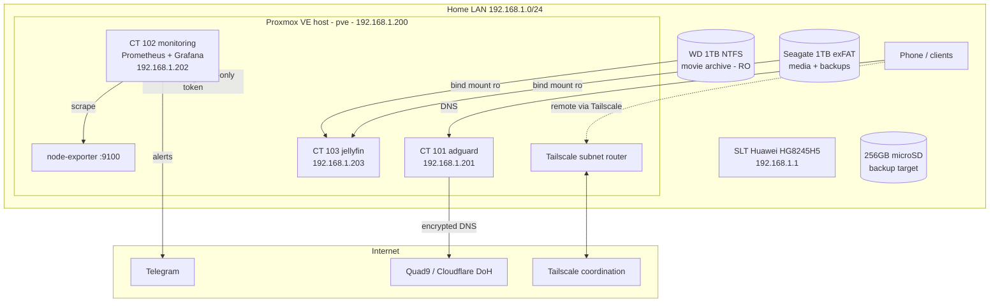
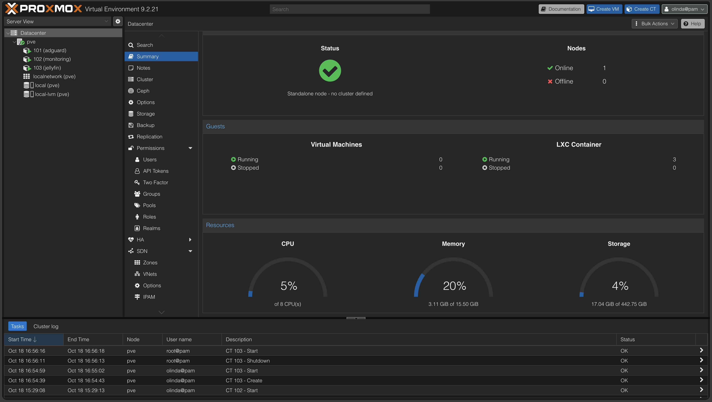
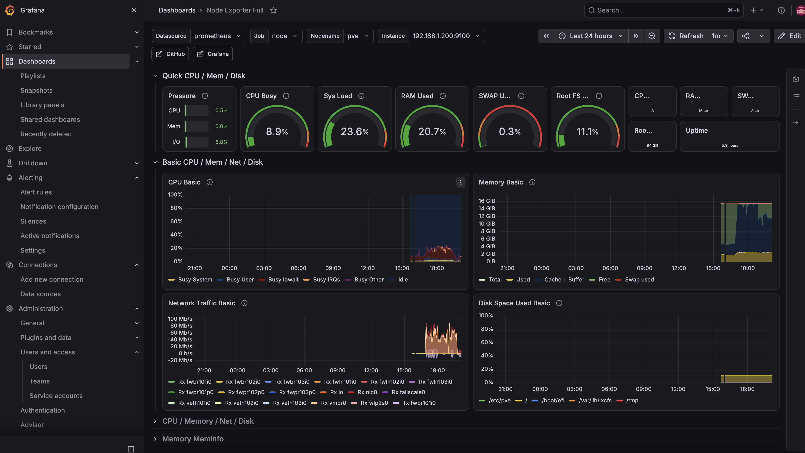
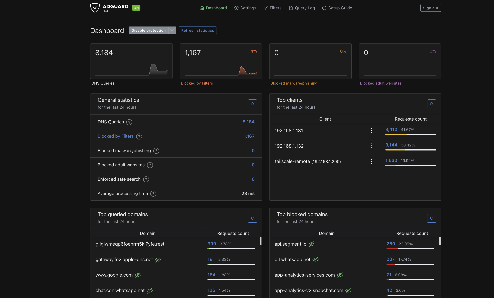
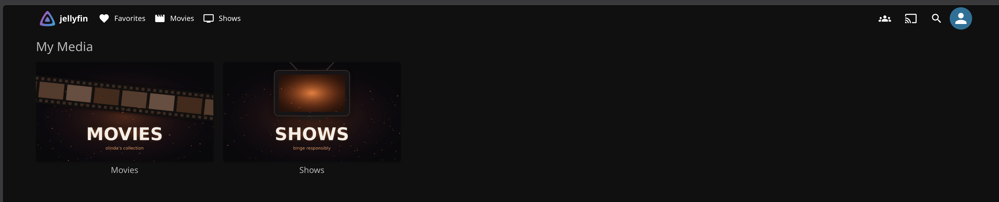

# 🏠 Homelab

A single-node Proxmox homelab built on a repurposed Dell Latitude laptop.
It provides network-wide ad blocking, full observability with alerting, secure
remote access, and a media server with hardware transcoding, built entirely on
free and open-source software (plus Tailscale's free tier).

> Built to learn infrastructure and architecture fundamentals hands-on:
> virtualization, least privilege, observability, zero-trust remote access, and
> documented, reproducible configuration.

## Architecture



## Hardware

| Component | Spec |
|---|---|
| Host | Dell Latitude, Intel Core i7 (Kaby Lake), 16 GB RAM |
| Boot / VM storage | 512 GB Intel NVMe (LVM-thin) |
| Media archive | HGST 1 TB 2.5" in WD Elements enclosure, NTFS, **read-only** |
| Media + personal data | Seagate 1 TB 2.5", exFAT |
| Backup target | 256 GB microSD (built-in reader), ext4 |
| Network | Built-in Intel GbE (e1000e), wired to router |

## Services

| ID | Name | IP | Purpose | Resources |
|---|---|---|---|---|
| - | pve | 192.168.1.200 | Proxmox VE 9.2 host, Tailscale subnet router | - |
| 101 | adguard | 192.168.1.201 | AdGuard Home DNS filtering | 1 core, 512 MB, 4 GB |
| 102 | monitoring | 192.168.1.202 | Prometheus, Grafana, pve-exporter | 2 cores, 2 GB, 16 GB |
| 103 | jellyfin | 192.168.1.203 | Jellyfin with Intel Quick Sync | 4 cores, 4 GB, 16 GB |

All containers are **unprivileged LXC** on Debian 13, set to start at boot.

## IP plan

| Range | Use |
|---|---|
| 192.168.1.1 | Router / gateway |
| 192.168.1.2 – .199 | Router DHCP pool (shrunk from .254) |
| 192.168.1.200 – .254 | Reserved for homelab static IPs |

## Documentation

| Doc | Topic |
|---|---|
| [01 Proxmox install](docs/01-proxmox-install.md) | Install, repos, updates, SD card |
| [02 Hardening](docs/02-hardening.md) | Non-root admin, SSH keys, laptop-as-server tweaks |
| [03 AdGuard Home](docs/03-adguard.md) | Network DNS filtering |
| [04 Monitoring](docs/04-monitoring.md) | Prometheus, Grafana, exporters |
| [05 Alerting](docs/05-alerting.md) | Grafana → Telegram alert rules |
| [06 Tailscale](docs/06-tailscale.md) | Remote access, subnet routing, DNS |
| [07 Storage](docs/07-storage.md) | External drives, mount strategy, SMART |
| [08 Jellyfin](docs/08-jellyfin.md) | Media server, GPU passthrough, libraries |
| [09 Media workflow](docs/09-media-workflow.md) | Getting new media onto the server |
| [Runbook](docs/runbook.md) | Day-to-day operations and recovery |
| [Decisions](docs/decisions.md) | Architecture decision records |
| [Lessons learned](docs/lessons-learned.md) | Things that went wrong and why |
| [Roadmap](docs/roadmap.md) | What's next |

## Repo layout

```
configs/    sanitized config files as deployed (no secrets)
scripts/    helper scripts
docs/       build notes, runbook, decisions
```

Secrets (API tokens, passwords, bot tokens) are **never** committed. See `.gitignore`.


## The setup


| Proxmox | Grafana |
|---|---|
|  |  |

| AdGuard Home | Jellyfin |
|---|---|
|  |  |
