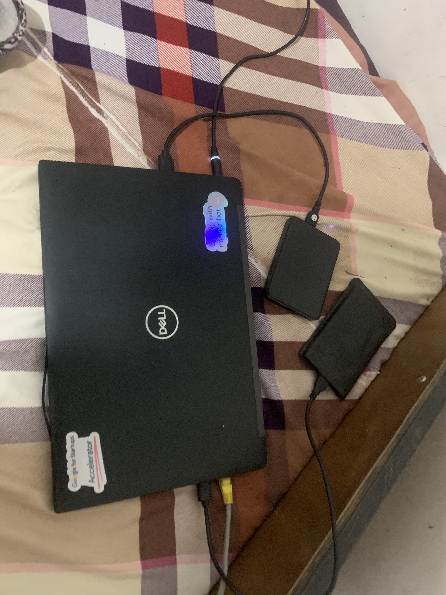

# Screenshots

Photos and screenshots of the homelab.

## Hardware

An old Dell Latitude running Proxmox, with two external drives and a wired connection to the router.

## Proxmox VE

The host running three unprivileged LXC containers: AdGuard, monitoring, and Jellyfin.

## Grafana

Host metrics (CPU, memory, disk, network) collected by Prometheus.

## AdGuard Home

DNS filtering for my devices, blocking ads and trackers.

## Jellyfin

My own media server, with custom library tiles.

---

*Screenshots are cropped to hide personal details. Photo location data has been removed.*
